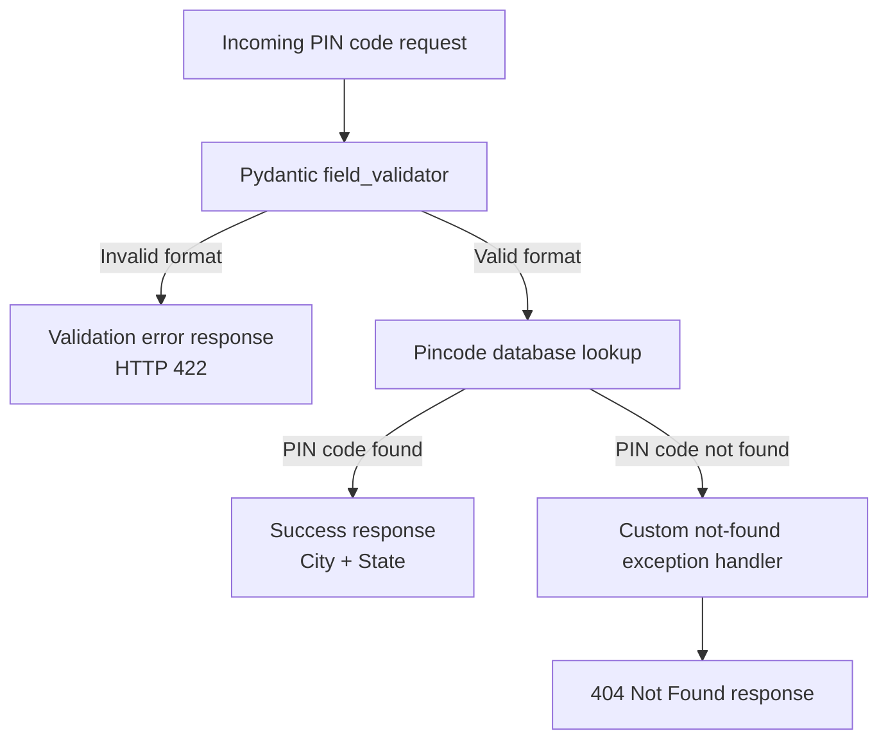

# PinCode Lookup API

API architecture and request-response flow for looking up a city's state from a PIN code.

## Architecture and Logic Flow

## API Contract

| Condition | Processing | Outcome |
|---|---|---|
| PIN code has an invalid format | Pydantic `field_validator` rejects the input before lookup | Error response; FastAPI validation errors use HTTP `422 Unprocessable Entity` |
| PIN code is valid and exists | The lookup returns the matching record | Success response containing the corresponding city and state |
| PIN code is valid but does not exist | The lookup raises the custom not-found exception, handled by the API | HTTP `404 Not Found` |

Invalid input does not reach the database lookup. Only a validly formatted PIN code is looked up.
